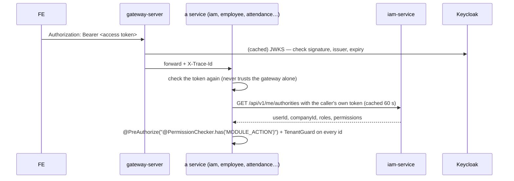

# ERP backend

Multi-company ERP SaaS as microservices on Spring Boot 3.5 / Java 17 (package `com.terp.erp`). Keycloak proves who
the caller is; the IAM service decides which company they belong to and what they may do. The services below cover
all 20 sections of the user manual: HR, inventory, sales/purchase/POS, accounting, CRM, projects, support and company
settings. Business events go through a transactional outbox to RabbitMQ; notification-service turns them into
emails, Slack / Telegram messages and webhooks.

Ports are the container ports. `docker-compose.yml` (project `erp`) publishes them on the host **+10000**, so the
gateway is `http://localhost:18080` and Keycloak `http://localhost:18180` — this keeps it apart from other local
stacks that use the plain ports.

| Module | Port (host) | What it does |
|---|---|---|
| `gateway-server` | 8080 (18080) | One entry point for the FE (`/api/v1/**`). Rejects requests without a valid Keycloak token, sets `X-Trace-Id`, rate-limits the public career and device endpoints, routes to services. Makes no permission decision. |
| `iam-service` | 8081 (18081) | Companies (tenants), user accounts, roles, permissions, login facade over Keycloak; SaaS plans, subscriptions, orders, coupons, currencies, payments, referrals; impersonation, IP rules, languages, email templates, settings, public site. Database `erp_iam`. |
| `media-service` | 8082 (18082) | Media library: folders, uploads (type checked from the bytes, svg/html refused), stats, time-limited signed view/download links. Files on volume `media-data`, rows in `erp_media`. Super admin sees every company; a company only its own. |
| `employee-service` | 8083 (18083) | Employees and organisation (branch > department > designation), announcements, awards, certificates/letters, holidays, lifecycle (promotion, transfer, warning, complaint, trip, resignation, termination), performance, training, Excel import/export. Bank number and tax id encrypted (AES-GCM). Database `erp_employee`. |
| `attendance-service` | 8084 (18084) | Shifts, attendance policies, records, regularizations, biometric device push, timesheets, leave, payroll summary. Database `erp_attendance`. |
| `recruitment-service` | 8085 (18085) | Job postings, public career page, candidates, interview rounds and interviews, assessments, offers and offer templates, onboarding. Files on volume `recruitment-data`, database `erp_recruitment`. |
| `payroll-service` | 8086 (18086) | Salary components, employee salaries, payroll runs, payslips, dashboard; reads employee and attendance data with the caller's token. Database `erp_payroll`. |
| `asset-service` | 8087 (18087) | Asset types, assets, assignments, maintenance, depreciation. Database `erp_asset`. |
| `meeting-service` | 8088 (18088) | Meeting types and rooms, meetings, action items, company events, Zoom meetings (client secrets encrypted). Database `erp_meeting`. |
| `document-service` | 8089 (18089) | Document categories, employee contracts, HR documents, templates. Database `erp_document`. |
| `report-service` | 8090 (18090) | Dashboards and the unified calendar, read from the other services (no database of its own). |
| `inventory-service` | 8091 (18091) | Items (product / service / part, images from media), categories, taxes, units, warehouses, stock and stock movements, transfers. Stock moves are all-or-nothing and idempotent per source. Database `erp_inventory`. |
| `commerce-service` | 8092 (18092) | Quotations, proposals, sales invoices and returns, purchase invoices and returns, POS. Posting moves stock through inventory and books the journal entry in accounting, with the caller's token. Database `erp_commerce`. |
| `accounting-service` | 8093 (18093) | Customers, vendors, VAS TT200 chart of accounts, journal entries (manual and automatic, idempotent per source), bank accounts and transfers, revenue / expense, payments, credit / debit notes, reports (trial balance, P&L, cash flow, balance sheet, aging, tax), year-end close, financial goals and budgets. Database `erp_accounting`. |
| `crm-service` | 8094 (18094) | Pipelines and stages, leads, deals (tasks, calls, emails, files), lead → deal conversion, customer contracts. Database `erp_crm`. |
| `project-service` | 8095 (18095) | Projects, tasks and bugs with Kanban, milestones, task calendar; form builder with a public link. Database `erp_project`. |
| `support-service` | 8096 (18096) | Support tickets with custom fields, public support portal per company, knowledge base and FAQ (CSV import), contact messages, one-to-one messenger. Database `erp_support`. |
| `notification-service` | 8097 (18097) | Consumes the `erp.events` exchange (queue `erp.notification.events`, dead letters in `erp.events.dlq`), deduplicates on `eventId`, sends email (company or platform SMTP, the company's per-event switch), Slack / Telegram (when the integration is on) and signed webhooks; delivery log with retry. Channel settings come from IAM's internal API with its own service account. Database `erp_notification`. |
| `erp-common` | — | Library shared by the servlet services: API envelope, error handling + i18n, trace id, resource-server setup, `ErpPrincipal`, `PermissionChecker`, `TenantGuard`; opt-in transactional outbox (`com.terp.erp.outbox`, `erp.outbox.enabled`) and the SSRF guard / outbound POST (`com.terp.erp.net`). |
| RabbitMQ 3.13 | 5672 (15673), UI 15672 (25672) | Topic exchange `erp.events` (routing key = event type, e.g. `support.ticket.created`). Producers today: commerce, accounting, support, recruitment, crm. |
| Keycloak 26 | 8080 (18180) | Realm `erp`: passwords, sessions, brute-force lockout, token signing. Clients `erp-web` (FE), `erp-iam-admin`, `erp-employee-service`, `erp-document-service`, `erp-notification-service`. Config in `deploy/keycloak/erp-realm.json`. Realm `erp-customer` (`deploy/keycloak/erp-customer-realm.json`, ADR-001): B2C customers only — public PKCE clients `erp-shop-web` / `erp-shop-app`, self-registration, issuer `http://localhost:18180/realms/erp-customer`; every ERP API refuses its tokens (other issuer). An existing stack gets it by recreating the Keycloak container (import skips realms that exist). E2E-only direct-grant client + test customer: `node e2e/customer-client.mjs` (local/CI, never in the realm JSON). |
| MySQL 8.4 | 3306 (13316) | One database per service (`erp_*`) plus `keycloak`, created by `deploy/mysql/init`. |

## How a request is authorized



Three checks, all required on every endpoint:

1. **Authenticated** — a Keycloak token (gateway and service).
2. **Permission** — `@PreAuthorize("@PermissionChecker.has('IAM_ROLE_VIEW')")`. Codes are `MODULE_ACTION`, seeded by
   Liquibase in the IAM database, granted through company roles. Permissions are **not** in the token: a role change,
   a locked account or a suspended company applies within the cache TTL (30 s in IAM, 60 s in other services), not at
   token expiry.
3. **Company isolation** — every row carries `company_id`. `TenantGuard.resolveCompany(...)` picks the company a
   list or create acts on (a company user can only ever get their own); `TenantGuard.assertSameCompany(...)` on every
   read/write by id answers **404** for another company's row.

`SUPER_ADMIN` is a Keycloak realm role: operates the SaaS (companies), passes every permission check, belongs to no
company and must pass `companyId` explicitly when acting on one.

Rules enforced in IAM: a caller can only grant permissions — directly in a role or through assigning a role — that
they hold themselves (`IAM_015`); `COMPANY_ADMIN` keeps every IAM permission (`IAM_012`); system roles keep their code
and cannot be deleted; nobody changes their own roles or status (`IAM_013`).

## API (through the gateway, `http://localhost:18080`)

IAM endpoints below; the other services follow the same rules under their own prefixes — media `/api/v1/media/**`;
employee `/api/v1/employees`, `/org/**`, `/lifecycle/**`, `/performance/**`, `/training/**`; attendance
`/api/v1/attendance/**`; recruitment `/api/v1/recruitment/**` + public `/api/v1/public/career/**`; payroll
`/api/v1/payroll/**`; asset `/api/v1/asset/**`; meeting `/api/v1/meeting/**`; document `/api/v1/document/**`;
report `/api/v1/reports/**` (each service has its own Swagger UI on its port).

| Method | Path | Who |
|---|---|---|
| POST | `/api/v1/auth/login` `{username, password}` → `{accessToken, refreshToken, expiresIn, refreshExpiresIn}` | public |
| POST | `/api/v1/auth/refresh-token` `{refreshToken}` (rotates: the old one stops working) | public |
| POST | `/api/v1/auth/logout` `{refreshToken}` | public |
| POST | `/api/v1/auth/initial-password` `{username, currentPassword, newPassword}` | public — first login with a temporary password (`AUTH_004`) |
| GET | `/api/v1/me` → user, companyId, roles[], permissions[] | any account |
| GET | `/api/v1/iam/permissions` | `IAM_PERMISSION_VIEW` |
| GET/POST/PUT/DELETE | `/api/v1/iam/roles[/{id}]` | `IAM_ROLE_*` |
| GET/POST | `/api/v1/iam/users`, PUT `/{id}/roles`, PUT `/{id}/status` | `IAM_USER_*` |
| GET/POST | `/api/v1/iam/companies`, PUT `/{id}/status` | super admin |
| GET | `/api/v1/saas/plans`, `/api/v1/saas/subscription` | `SAAS_SUBSCRIPTION_VIEW` |
| POST | `/api/v1/saas/orders/quote`, `/api/v1/saas/orders` `{planId, billingCycle, couponCode?, paymentReference?}`; GET `/api/v1/saas/orders`; POST `/orders/{id}/cancel` | `SAAS_ORDER_*` |
| CRUD | `/api/v1/saas/admin/plans`, `/api/v1/saas/admin/coupons`; GET `/admin/orders`, POST `/admin/orders/{id}/approve\|reject`; PUT `/admin/companies/{id}/subscription` | super admin |

### Subscriptions (SaaS)

New companies get the default plan (trial when the plan has `trialDays`). A paid order is a bank transfer: the
company orders (price + coupon frozen), transfers with the order number as content, a super admin approves → the
plan runs 1 month / 1 year (renewing the running plan extends it). When a plan expires the company falls back to the
default plan; with no default it is **EXPIRED**: employees cannot log in (`AUTH_009`), `COMPANY_ADMIN` logs in with
the `SAAS_*` permissions only, to renew. `maxUsers` is enforced when accounts are created; `maxEmployees` and
storage are stored for later services. Companies without a plan (e.g. the bootstrap company) have no limits.
Bank account shown with pending orders: `SAAS_BANK_NAME`, `SAAS_BANK_ACCOUNT_NUMBER`, `SAAS_BANK_ACCOUNT_NAME`.

Envelope `{ result, code, data, message, traceId }`; errors carry a stable `code` (`AUTH_00x`, `IAM_0xx`,
`COMMON_00x`) and a message in `Accept-Language` (vi default, en, ko). Swagger UI: `http://localhost:18081/swagger-ui.html`
(IAM directly; the gateway does not expose it).

## Run locally

```bash
mvn -DskipTests package            # builds the jars the Dockerfiles copy
# set these in the shell or in a .env file next to docker-compose.yml (gitignored, never commit it):
#   MYSQL_ROOT_PASSWORD, IAM_DB_USERNAME, IAM_DB_PASSWORD, KC_DB_USERNAME, KC_DB_PASSWORD,
#   KC_BOOTSTRAP_ADMIN_USERNAME, KC_BOOTSTRAP_ADMIN_PASSWORD,
#   KEYCLOAK_ADMIN_CLIENT_SECRET          (secret of client erp-iam-admin; realm import and IAM read the same value)
#   ERP_SUPERADMIN_INITIAL_PASSWORD       (temporary; ≥10 chars, upper, lower, digit)
#   MEDIA_DB_PASSWORD, MEDIA_LINK_SECRET  (media-service; the link secret is random, ≥ 32 chars)
#   EMPLOYEE_DB_PASSWORD, EMPLOYEE_ENC_KEY (employee-service; key = openssl rand -base64 32)
#   ATTENDANCE_DB_PASSWORD               (attendance-service)
#   RECRUITMENT_DB_PASSWORD              (recruitment-service)
#   PAYROLL_DB_PASSWORD                  (payroll-service; an existing MySQL volume needs the database
#                                          and user created by hand — the init script runs only once)
#   ASSET_DB_PASSWORD                    (asset-service; same note for an existing MySQL volume)
#   MEETING_DB_PASSWORD                  (meeting-service; same note for an existing MySQL volume)
#   MEETING_ENC_KEY                      (meeting-service; encrypts Zoom client secrets: openssl rand -base64 32)
#   DOCUMENT_DB_PASSWORD                 (document-service; same note for an existing MySQL volume)
#   INVENTORY_DB_PASSWORD, COMMERCE_DB_PASSWORD, ACCOUNTING_DB_PASSWORD, CRM_DB_PASSWORD, PROJECT_DB_PASSWORD
#                                        (one per service; same note for an existing MySQL volume)
#   SUPPORT_DB_PASSWORD                  (support-service, database erp_support / user erp_support; same note
#                                          for an existing MySQL volume)
#   EMPLOYEE_SERVICE_CLIENT_SECRET        (secret of client erp-employee-service; realm import and employee-service)
#   DOCUMENT_SERVICE_CLIENT_SECRET        (secret of client erp-document-service; realm import and document-service)
#   NOTIFICATION_DB_PASSWORD             (notification-service, database erp_notification / user erp_notification;
#                                          same note for an existing MySQL volume)
#   STORE_DB_PASSWORD                    (store-service, database erp_store / user erp_store; an existing MySQL
#                                          volume needs the database and user created by hand)
#   NOTIFICATION_SERVICE_CLIENT_SECRET    (secret of client erp-notification-service; realm import and
#                                          notification-service — an existing realm needs the client added by hand)
#   STORE_SERVICE_CLIENT_SECRET           (secret of client erp-store-service; realm import and store-service —
#                                          an existing realm needs the client added by hand)
#                                          An ERP stack created before store-service: add both STORE_* values to
#                                          .env, then run scripts/upgrade-store-service.sh (DB, Keycloak client, services).
#   MEMBER_DB_PASSWORD                   (member-service, database erp_member / user erp_member)
#   MEMBER_SERVICE_CLIENT_SECRET          (secret of client erp-member-service; realm import and member-service).
#                                          A stack created before member-service: run scripts/upgrade-member-service.sh.
#   RABBITMQ_USER, RABBITMQ_PASSWORD      (broker account; rabbitmq, notification-service and the producers
#                                          commerce, accounting, support, recruitment, crm)
#   SEAWEEDFS_S3_ACCESS_KEY, SEAWEEDFS_S3_SECRET_KEY (local SeaweedFS, the S3 storage of media-service; random —
#                                          media-service uses this key unless MEDIA_S3_ACCESS_KEY/SECRET_KEY are set)
#   ERP_SETTINGS_ENC_KEY                  (optional; base64 of 32 random bytes — needed to save the SMTP password
#                                          or reCAPTCHA secret in Settings: openssl rand -base64 32)
# optional: ERP_CORS_ORIGINS, ERP_WEB_REDIRECT_URI (FE origin, default http://localhost:5173), SAAS_BANK_NAME,
#   SAAS_BANK_ACCOUNT_NUMBER, SAAS_BANK_ACCOUNT_NAME, *_DB_USERNAME (default erp_<service>)
#   MEDIA_S3_ENDPOINT, MEDIA_S3_REGION, MEDIA_S3_BUCKET, MEDIA_S3_ACCESS_KEY, MEDIA_S3_SECRET_KEY,
#   MEDIA_S3_PATH_STYLE, MEDIA_S3_PREFIX, MEDIA_S3_CREATE_BUCKET (media-service S3 / Wasabi storage; compose defaults
#     to SeaweedFS http://seaweedfs:8333, bucket erp-media, path style, bucket created on first use. Real S3/Wasabi: https
#     endpoint, a key limited to the bucket, CREATE_BUCKET=false. The driver itself is chosen by the super admin in
#     Settings -> Storage (LOCAL / S3 / WASABI); test it with POST /api/v1/media/storage/test)
#   DB_POOL_SIZE (Hikari pool per service, default 5; MySQL runs with --max-connections=400)
#   GEOIP_CITY_DB, GEOIP_ASN_DB (iam-service; compose mounts deploy/geoip read-only — put GeoLite2-City.mmdb and
#                                 GeoLite2-ASN.mmdb there for login city/country/ISP, see deploy/geoip/README.md)
docker compose up -d --build       # compose project "erp": containers erp-*, volumes erp_*, host ports +10000
```

FE settings for this stack: API `http://localhost:18080/api/v1`, Keycloak realm `erp`, client `erp-web`,
issuer `http://localhost:18180/realms/erp`.

First steps: `POST /api/v1/auth/initial-password` for `superadmin` → `POST /api/v1/iam/companies` (creates the
company, its default roles and the first `COMPANY_ADMIN`, whose temporary password is returned once) → that admin
sets a password with `initial-password` and manages users and roles.

The realm is imported only when it does not exist yet; after editing `erp-realm.json` on a local stack, recreate it
(`docker compose down -v` — this deletes the local databases).

## Tests

`mvn package` runs the unit tests of all modules (1000 on 2026-11-22): tenant guard, permission checker, role
escalation rules, login gating, the business rules of each service, journal postings, SSRF guard.

End-to-end checks run against the ERP stack through the gateway, with two fake companies each:
- `.claude/scripts/e2e-login.mjs` (26 checks): no-token 401, temporary password → `AUTH_004`, first-login password,
  company creation with its `COMPANY_ADMIN`, cross-company read → 404, changing your own status → `IAM_013`, missing
  permission → 403, locked user and suspended company tokens rejected, refresh-token rotation, logout. It leaves test
  companies `E2EA_/E2EB_<random>` behind.
- Per-module E2E runs were done for every manual section before its PR (results in each PR's test plan); those
  scripts are not in the repo yet.
- The public career, support and form endpoints are rate-limited per IP (writes: burst 5, 10/min). Running their
  checks back to back returns 429 until the bucket refills (about a minute).

## Status

What still needs a decision or is not built (2026-11-22):

- **Notifications, stage 1.** Dispatched events: sales / purchase invoice posted, customer payment cleared, support
  ticket created / replied, job application received, CRM lead / deal assigned and moved (email, Slack, Telegram,
  webhooks). Twilio, AI and Google Calendar are stored but unused; the other catalog events have no producer yet.
- **Cross-service postings still synchronous.** The outbox exists (erp-common) but commerce → accounting postings
  do not use it yet. A commerce post runs: accounting validate-only → stock move → journal post.
  If the journal post fails after the stock move, the document stays draft with stock moved; a retry completes it
  (both calls are idempotent). Clearing a customer payment marks the commerce invoice paid before the journal is
  written, with no compensation.
- **To confirm with the chief accountant:**
  - the accounts used by automatic journal entries, all changeable through the system account mapping:
    - sales: 131 / 5111 / 5113 / 33311
    - cost of sales: 632 / 156, at the item's purchase price
    - sales returns: 5213
    - purchases: 156 / 6428 / 1331 / 331
    - payroll: 6421 / 334
  - the costing method (`06_ARQ_Register`)
  - documents posted before automatic journals (#20) were not back-posted
- **To confirm with the BA (`TODO(assumption)` in the code):** status transition tables (trip, HR document, employee
  contract), a completed performance review can't be reopened, recruitment offer approval rules, support portal
  rules (no public attachments, items start unpublished).
- **Security notes:**
  - outbound integration and webhook URLs pass an SSRF guard, but there is no IP pinning, so a DNS-rebinding window
    remains
  - the attendance IP allow-list trusts the gateway's `X-Client-IP`, while services are also published on host
    ports locally
- **Platform:**
  - IAM is a single point of failure: permission checks fail closed
  - creating a user writes Keycloak first, so a database failure leaves an orphan Keycloak user
  - login uses the password grant through IAM; PKCE is preferred if the FE can change
  - no CI workflow, Testcontainers, ShedLock or tracing backend yet

## Adding a service

1. Depend on `erp-common`, scan `com.terp.erp`, configure security with
   `ResourceServerSecurity.apply(http, new RemoteAuthorityResolver(iamUrl, Duration.ofSeconds(60)), mapper, …)`.
2. Seed its permission codes in IAM (new Liquibase change file) and add them to `EDefaultRole` where a default role
   should have them.
3. Every table with company data gets `company_id`; every list uses `TenantGuard.resolveCompany`, every by-id access
   `TenantGuard.assertSameCompany`.
4. Add a route in `services/gateway-server/src/main/resources/application.yml`.
